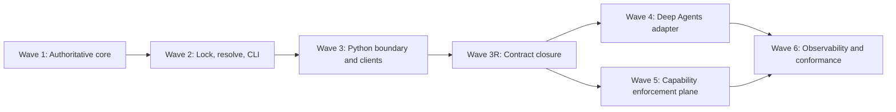

# Kiteframe V1 Wave Roadmap Implementation Plan

> **Superseded (2026-08-11):** Historical plan retained for context. The active
> replacement plan is the
> [Minimal Workflow Engine Implementation Plan](2026-08-11-kiteframe-minimal-workflow-engine.md).

> **For agentic workers:** REQUIRED SUB-SKILL: Use superpowers:subagent-driven-development (recommended) or superpowers:executing-plans to implement this plan task-by-task. Steps use checkbox (`- [ ]`) syntax for tracking.

**Goal:** Land Kiteframe V1 alpha as six numbered waves plus one mandatory Wave 3R contract-closure delivery, with one authoritative portable core and a secure Deep Agents delivery.

**Architecture:** Rust owns the portable contract and every deterministic build decision. Python receives immutable Rust projections and supplies runtime-specific construction, while the capability provider performs dynamic admission and point-of-use authorization outside the portable core. Wave 3R closes the incomplete Wave 3 consumer boundary before either runtime construction or enforcement work begins; no delivery claims safety properties assigned to a later gate.

**Tech Stack:** Rust 1.97.1, Cargo edition 2024, Python 3.11+, maturin/PyO3, Deep Agents 0.6.12, OpenFGA, OpenTelemetry, JSON Schema 2020-12, RFC 8785 canonical JSON, SHA-256.

## Global Constraints

- `agent.yaml` MUST NOT contain runtime code, executable import paths, endpoints, credentials, bearer grants, OpenFGA tuples, or deployment secrets.
- Rust is the single authority for parsing, exhaustive validation, containment, normalization, capability resolution, lock verification, hashes, feature negotiation, diagnostics, and `ResolvedAgent` construction.
- Portable core crates MUST NOT depend on Deep Agents, other runtime frameworks, OpenFGA, or OpenTelemetry SDK object types.
- V1 hashes use SHA-256, lowercase hexadecimal encoding, and a domain-separation prefix in the hashed bytes.
- Typed values are normalized as RFC 8785 canonical JSON; input and output schemas use JSON Schema 2020-12 and forbid remote `$ref` resolution.
- Absence is deny, explicit deny wins, and bindings, admission, and delegation may only narrow portable authority.
- Required unsupported semantics fail compilation; optional unsupported semantics produce a stable machine-readable warning in the compilation report.
- Every capability invocation is reauthorized at point of use. Cached admission never overrides revocation or stale policy.
- Every effectful invocation carries an idempotency key and obtains a durable write-ahead audit receipt before the effect executes.
- Telemetry content capture is disabled by default, and telemetry failure never changes authorization or invocation outcomes.
- The Deep Agents adapter is pinned to `deepagents==0.6.12` and upstream commit `196a0870fcf8a7f29d1fb37886dd323b190f9c16`.
- OpenHarness integration and second-runtime portability proof are V2 work and MUST NOT gate or expand V1.

---

## Wave Dependency Graph



Wave 3R is a mandatory closure gate, not a seventh numbered product wave. Wave 5 can begin after Wave 3R while Wave 4 is under review; Wave 2 reaches Wave 5 only through the closed Wave 3R contracts. Wave 6 begins only after both runtime construction and provider enforcement have passed their independent gates.

## Spec Coverage

| Design area | Owning wave |
|---|---|
| Trust zones, exhaustive manifest/binding schemas, parser limits, containment, assets, nested packages | Wave 1 |
| Canonical JSON, domain-separated hashes, descriptor semantics, catalog resolution, locks, features, model roles, immutable IR, CLI | Wave 2 |
| Initial service contracts, immutable PyO3 values, generated stubs, component registry, strict provider HTTP client | Wave 3 implementation |
| Retained runtime compilation inputs, embedded locked descriptors, structured provider projections, traced status requests, authority revisions, authentication, catalog fetch results, and complete suspension correlation, as specified by [`the Wave 3R addendum`](../specs/2026-07-28-kiteframe-wave-3r-contract-closure-design.md) | Wave 3R |
| Pinned Deep Agents public API, typed tools, dynamic visibility, ambient denial, subagents, concurrency, suspension | Wave 4 |
| Admission, authority intersection, point-of-use checks, OpenFGA, freshness, evidence, preconditions, status, idempotency, audit, provider routes | Wave 5 |
| OpenTelemetry, privacy-gated capture, end-to-end failures, fuzz/restart/concurrency, requirement traceability, V1 release decision | Wave 6 |

## Wave Trackers

- [ ] **Wave 1 — Authoritative contracts and hostile package loading**
  - Plan: [`2026-07-25-kiteframe-v1-wave-1-authoritative-core.md`](2026-07-25-kiteframe-v1-wave-1-authoritative-core.md)
  - Exit: a Rust API loads a contained package, rejects hostile YAML and paths, emits normative schemas, and produces deterministic portable digests.

- [ ] **Wave 2 — Capability lock, deterministic resolution, CLI, and golden IR**
  - Plan: [`2026-07-25-kiteframe-v1-wave-2-lock-resolve-cli.md`](2026-07-25-kiteframe-v1-wave-2-lock-resolve-cli.md)
  - Exit: `kiteframe check`, `lock`, `explain`, and `compile` operate through one Rust pipeline; locked compilation emits canonical `ResolvedAgent` fixtures.

- [ ] **Wave 3 — Immutable Python boundary, component registry, and provider clients**
  - Plan: [`2026-07-25-kiteframe-v1-wave-3-python-contract.md`](2026-07-25-kiteframe-v1-wave-3-python-contract.md)
  - Implementation: merged at `54a2175`; the adversarial review found that its consumer-boundary exit assumptions did not hold.
  - Exit: **not passed** until Wave 3R closes the boundary. Waves 4 and 5 MUST NOT consume the merged Wave 3 surface directly.

- [ ] **Wave 3R — Mandatory Python contract closure**
  - Plan: [`2026-07-28-kiteframe-v1-wave-3r-contract-closure.md`](2026-07-28-kiteframe-v1-wave-3r-contract-closure.md)
  - Exit: Python receives complete frozen compilation inputs, exact locked descriptors, structured outcomes/statuses, traced status requests, effective authority revisions, authenticated provider/catalog results, and restart-safe suspension correlation without reconstructing alternate models.

- [ ] **Wave 4 — Secure Deep Agents adapter**
  - Plan: [`2026-07-25-kiteframe-v1-wave-4-deep-agents.md`](2026-07-25-kiteframe-v1-wave-4-deep-agents.md)
  - Exit: the pinned public `create_deep_agent(...)` surface returns a `CompiledStateGraph`; built-ins and general delegation are default-denied; nested agents narrow authority; suspension requires durable checkpointing.

- [ ] **Wave 5 — Capability provider, OpenFGA, idempotency, and audit**
  - Plan: [`2026-07-25-kiteframe-v1-wave-5-enforcement-plane.md`](2026-07-25-kiteframe-v1-wave-5-enforcement-plane.md)
  - Exit: the HTTP provider separates admission from point-of-use checks, pins the OpenFGA model, validates results, orders audit before effects, and resolves retries through durable invocation status.

- [ ] **Wave 6 — Observability and end-to-end conformance**
  - Plan: [`2026-07-25-kiteframe-v1-wave-6-observability-conformance.md`](2026-07-25-kiteframe-v1-wave-6-observability-conformance.md)
  - Exit: the complete V1 failure matrix passes with stable trace/audit correlation, adversarial hardening, and requirement-to-test evidence.

## Cross-Wave Contract Freeze

The following names are frozen when their producing wave merges. A later wave may add fields only when the schema version and compatibility fixtures permit it.

| Producer | Contract | Consumers |
|---|---|---|
| Wave 1 | `Diagnostic`, `DiagnosticCode`, `AgentManifest`, `RuntimeBinding`, `AgentPackage`, `Sha256Digest`, `PackagePath` | Waves 2–6 |
| Wave 2 | `CapabilityDescriptor`, `CapabilityLock`, `ResolvedAgent`, `CompilationReport`, canonical fixture corpus | Wave 3 and Wave 3R |
| Wave 3 | Merged provisional PyO3/provider boundary; its consumer freeze is superseded by Wave 3R | Wave 3R only |
| Wave 3R | `ResolvedRuntimeInputs`, `ResolvedCapabilityRequirement` with exact embedded `LockedCapability` and exposed descriptor/digests, `EffectiveCapabilityGrant`, `AuthorityRevisionSet`, `StatusRequest`, `CatalogFetchResult`, `ProviderAuthenticator`, structured native outcome/status projections, strengthened `Suspension`, `FrozenComponentRegistry`, `AdmissionProvider`, `CapabilityInvoker`, `ProviderHttpClient` | Waves 4–6 |
| Wave 4 | `DeepAgentsAdapter`, `KiteframeSessionContext`, suspension envelope | Wave 6 |
| Wave 5 | `AuthorizationBackend`, `InvocationStore`, `AuditSink`, provider HTTP service | Wave 6 |

## Program-Level Verification

Run these commands after each wave merges:

```bash
rtk cargo fmt --all --check
rtk cargo clippy --workspace --all-targets --all-features -- -D warnings
rtk cargo test --workspace --all-features
rtk uv run --project python/kiteframe pytest
rtk uv run --project python/kiteframe-deepagents pytest
rtk git diff --check
```

Commands for projects not yet created in an earlier wave are added to CI only when that wave lands. Wave 6 adds the OpenFGA container suite, end-to-end suite, and fuzz smoke targets.

Wave 3R additionally runs its focused Rust/PyO3/Python contract suite and proves that package, binding, lock, target, descriptor, authority-revision, trace, and suspension data survive the real resolution-to-consumer path. Passing the pre-3R Wave 3 suite does not satisfy this gate.

## User-Journey Ownership

The ten journeys in `site/app/page.tsx` describe host experiences over Kiteframe contracts; they are not promises that Kiteframe owns a conversation product.

| Journey | Host owns | Kiteframe owns |
|---|---|---|
| Open or resume a conversation | Identity, tenant, conversation, checkpoint UX, and presentation | Declared package/runtime reconstruction and durable enforcement state |
| Ask a bounded question | Conversation, clarification, response streaming, and presentation | Declared runtime construction and authorized capability invocation |
| Investigate a problem | Investigation UX and report presentation | Declared specialist construction and capability-scoped evidence retrieval |
| Retrieve platform information | Request and result presentation | Point-of-use capability invocation and authorization correlation |
| Clarify an ambiguous request | Clarification dialogue and scope presentation | No authority until declared package/runtime inputs and bounded context are supplied |
| Review a proposal | Exact proposal presentation and user controls | Proposal digest and protected evidence-request correlation |
| Approve an effect | Approval UI and evidence capture | Durable suspension, evidence correlation, and reauthorization before effect |
| Track long-running work | Progress streaming, reconnect UX, and user-visible status | Durable invocation/status and suspension enforcement, not progress streaming |
| Understand an unavailable feature | Safe denial presentation and next-step UX | Structured denial and absence of ambient fallback |
| Continue with context | Conversation continuity and presentation | Task/session authority isolation and durable enforcement correlation |

Kiteframe does not provide a workflow DSL, task synthesis, conversation orchestration, or progress streaming. A host may provide those experiences while consuming Kiteframe's declared package/runtime construction, capability invocation, suspension/evidence correlation, and durable enforcement contracts.

### Site claim gate

Before V1 release review, `site/app/page.tsx` and `site/app/diagrams.ts` MUST
match this ownership matrix:

- the host bounds a request and supplies task/session context; Kiteframe
  resolves a published agent package rather than synthesizing a package from
  chat;
- packages declare prompts, skills, models, capabilities, delegation, and
  safety requirements, not portable workflow steps or per-request task
  input/output contracts;
- child packages are declared and authority-narrowed; V1 does not promise a
  separate typed child input/output protocol;
- the host may stream presentation progress derived from durable invocation
  and suspension status, but progress streaming is not a portable execution
  mode; and
- exact proposal presentation is host-owned while Kiteframe binds the
  protected proposal/evidence references and digest used for authorization.

A public claim that exceeds these boundaries blocks Wave 6 release review even
when lower-level tests pass.

## Crankshaft Platform Profile

Crankshaft's dual-principal authentication and workforce-management authority semantics drive a V1 conformance profile and test fixtures. This creates no cross-repository runtime dependency, and this roadmap does not claim that a Crankshaft capability provider or integration is implemented.

## Stop Conditions

- Do not begin Wave 1 runtime implementation until the design spec status is explicitly marked approved; creating these trackers does not itself land runtime code.
- Stop a wave when an exact interface from its prerequisite wave is missing; amend the producing plan instead of creating an alternate type.
- Stop Waves 4 and 5 until Wave 3R passes every contract-closure exit criterion; the merged Wave 3 implementation at `54a2175` is not sufficient.
- Stop Wave 3R if any consumer must reread package YAML, binding, lock, or target inputs; refetch a live catalog; hardcode a locked schema; or reconstruct a Python alternate model from canonical JSON.
- Stop Wave 4 if the pinned Deep Agents compatibility fixture cannot prove default denial without compilation-time process-global mutation.
- Stop effect execution when point-of-use policy is stale, required evidence is invalid, a precondition is missing, result validation fails, or the write-ahead audit append fails.
- Stop V1 release when a required conformance row lacks passing evidence; do not move the requirement to V2 merely to clear the gate.
