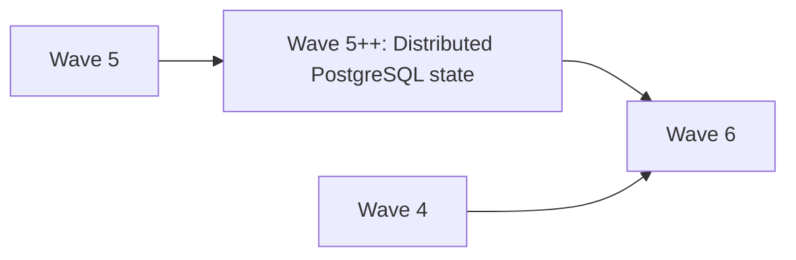

# Kiteframe V1 Wave 5++ Distributed PostgreSQL Store Implementation Plan

> **For agentic workers:** REQUIRED SUB-SKILL: Use superpowers:subagent-driven-development (recommended) or superpowers:executing-plans to implement this plan task-by-task. Steps use checkbox (`- [ ]`) syntax for tracking.

**Goal:** Make PostgreSQL the shared transactional authority for admissions, idempotency, invocation status, suspension, and crash recovery in replicated Kiteframe provider deployments.

**Architecture:** Add backend-neutral admission and execution-lease contracts to `kiteframe-provider`, preserve SQLite as the local/single-node reference implementation, and add `kiteframe-provider-postgres` for replicated deployments. PostgreSQL uses unique partial indexes, compare-and-swap transactions, database-clock lease expiry, and opaque fencing tokens; expired work becomes `OutcomeUnknown` and is never automatically replayed. Deployment composition explicitly selects one backend, migrations run as a dedicated command/job, and replicas only validate connectivity and schema readiness.

**Tech Stack:** Rust 1.97.1, Tokio, SQLx 0.8/lockfile 0.8.6, PostgreSQL 16+, rustls, UUID fencing tokens, Docker-backed integration tests.

## Global Constraints

- Wave 5 at `6f624fc` or a reviewed descendant is the prerequisite.
- Wave 5++ becomes a mandatory gate between Wave 5 and Wave 6 for replicated-provider conformance.
- PostgreSQL 16 is the compatibility floor; container tests pin `postgres:16.14-alpine3.23`, a currently supported release and official image. See the [PostgreSQL version policy](https://www.postgresql.org/support/versioning/) and [official image tag](https://hub.docker.com/_/postgres/tags?name=16&page=1).
- SQLite remains supported only for local and single-node reference deployments. In-memory stores remain test fixtures only.
- A deployment selects exactly one writable transactional store. No dual-write, backend auto-detection, or SQLite-to-PostgreSQL importer is introduced.
- Concurrent duplicates may dispatch an effect once, but PostgreSQL does not make an external side effect exactly-once. A crash, lost lease, or uncertain response produces status-first `OutcomeUnknown`; no replica steals and replays expired work.
- Lease expiry uses PostgreSQL `clock_timestamp()`, not pod clocks. Defaults are a 30-second reservation timeout, 30-second execution lease, and 10-second heartbeat.
- Production PostgreSQL connections require `sslmode=verify-full`; insecure connections are accepted only by an explicit loopback-test constructor.
- Pool defaults are 10 connections per replica and a 5-second acquire timeout. Deployment documentation must budget the aggregate connection count.
- SQLx embedded migrations retain locking and checksum validation. Replicas never call `Migrator::run`; only `kiteframe-provider store migrate` does so. See the [SQLx migrator](https://docs.rs/sqlx/0.8.6/sqlx/migrate/struct.Migrator.html) and [PostgreSQL pool options](https://docs.rs/sqlx/0.8.6/sqlx/postgres/type.PgPoolOptions.html).
- Migrations are forward-only and additive. Rollback means rolling back to a Wave 5++ binary compatible with the applied schema, never switching a live deployment back to SQLite.
- PostgreSQL stores audit receipt links, not the audit ledger itself. Replicated deployments must supply a shared durable `AuditSink`; the JSONL fixture is not production-capable.
- Do not add Helm, managed-PostgreSQL provisioning, or a general workflow/job queue.
- Preserve the checkout's unrelated Wave 3R, Wave 4, Wave 6, roadmap, and site edits. Execute in an isolated worktree and stage only each task's listed paths.

---

## File Structure

```text
crates/kiteframe-provider/
├── src/admission.rs              # Backend-neutral AdmissionStore
├── src/status.rs                 # Tenant scope and execution-lease contracts
└── src/invocation.rs             # Heartbeat, fencing, and lost-lease behavior

crates/kiteframe-provider-sqlite/
├── migrations/0003_provider_state_and_leases.sql
└── src/lib.rs                    # Local AdmissionStore + InvocationStore parity

crates/kiteframe-provider-postgres/
├── Cargo.toml
├── migrations/
│   ├── 0001_admissions.sql
│   └── 0002_invocations.sql
├── src/
│   ├── lib.rs
│   ├── config.rs
│   ├── migration.rs
│   ├── codec.rs
│   └── store.rs
└── tests/
    ├── support/mod.rs
    ├── migration.rs
    ├── store_contract.rs
    └── distributed_recovery.rs

crates/kiteframe-provider-http/
├── src/store_config.rs           # Explicit backend composition
└── src/main.rs                   # serve/store migrate/store check commands

docs/deployment/postgresql-invocation-store.md
```

### Task 1: Define shared admission and execution-lease contracts

**Files:**

- Modify: `crates/kiteframe-provider/src/admission.rs`
- Modify: `crates/kiteframe-provider/src/status.rs`
- Modify: `crates/kiteframe-provider/src/invocation.rs`
- Modify: `crates/kiteframe-provider/src/lib.rs`
- Test: `crates/kiteframe-provider/tests/admission.rs`
- Test: `crates/kiteframe-provider/tests/idempotency.rs`
- Test: `crates/kiteframe-provider/tests/audit_ordering.rs`

**Interfaces:**

```rust
#[async_trait]
pub trait AdmissionStore: Send + Sync {
    async fn save(&self, admission: PersistedAdmission) -> Result<(), Diagnostic>;
    async fn load(
        &self,
        admission_id: &AdmissionId,
        grant_digest: &Sha256Digest,
    ) -> Result<PersistedAdmission, Diagnostic>;
}

#[derive(Clone, Copy)]
pub struct InvocationLeasePolicy {
    reservation_timeout: Duration,
    execution_ttl: Duration,
    heartbeat_interval: Duration,
}

pub struct InvocationExecutionLease {
    invocation_id: InvocationId,
    token: String,
    generation: u64,
}

impl InvocationLeasePolicy {
    pub fn try_new(
        reservation_timeout: Duration,
        execution_ttl: Duration,
        heartbeat_interval: Duration,
    ) -> Result<Self, String>;

    pub fn production_default() -> Self;
}

impl InvocationExecutionLease {
    pub fn invocation_id(&self) -> &InvocationId;
    pub fn token(&self) -> &str;
    pub fn generation(&self) -> u64;
}

impl InMemoryInvocationStore {
    pub fn with_policy(lease_policy: InvocationLeasePolicy) -> Self;
    pub fn with_clock_and_policy(
        clock: Arc<dyn InvocationStoreClock>,
        lease_policy: InvocationLeasePolicy,
    ) -> Self;
}

#[async_trait]
pub trait InvocationStore: Send + Sync {
    fn lease_policy(&self) -> InvocationLeasePolicy;

    async fn reserve_or_get(
        &self,
        invocation: InvocationReservationInput,
        descriptor: &CapabilityDescriptor,
        retention_until: Timestamp,
    ) -> Result<InvocationReservation, Diagnostic>;

    async fn transition(
        &self,
        invocation_id: &InvocationId,
        transition: InvocationTransition,
    ) -> Result<(), Diagnostic>;

    async fn begin_execution(
        &self,
        invocation_id: &InvocationId,
        expected: InvocationState,
        authorization_record_id: &str,
    ) -> Result<InvocationExecutionLease, Diagnostic>;

    async fn renew_execution(
        &self,
        lease: &InvocationExecutionLease,
    ) -> Result<InvocationExecutionLease, Diagnostic>;

    async fn finish_execution(
        &self,
        lease: &InvocationExecutionLease,
        next: InvocationState,
        outcome_record_id: &str,
    ) -> Result<(), Diagnostic>;

    async fn forfeit_execution(
        &self,
        lease: &InvocationExecutionLease,
        outcome_record_id: Option<&str>,
    ) -> Result<(), Diagnostic>;

    async fn recover_expired(&self) -> Result<u64, Diagnostic>;

    async fn status(
        &self,
        request: &StatusRequest,
        context: &InvocationStatusContext,
    ) -> Result<InvocationStatus, Diagnostic>;

    async fn abandon(
        &self,
        invocation_id: &InvocationId,
        context: &InvocationStatusContext,
        authorization: AbandonmentAuthorization,
    ) -> Result<(), Diagnostic>;
}
```

- [ ] **Step 1: Write failing contract tests**

```rust
#[tokio::test]
async fn admission_saved_by_one_service_loads_through_another() {
    let store = Arc::new(InMemoryAdmissionStore::new());
    let first = admission_service(store.clone());
    let second = admission_service(store);
    let grant = admit(&first, admission_request()).await.unwrap();
    assert_eq!(
        second
            .load_admission(grant.admission_id(), grant.grant_digest())
            .await
            .unwrap()
            .grant_set(),
        &grant
    );
}

#[tokio::test]
async fn identical_actor_and_key_are_isolated_by_tenant() {
    let store = InMemoryInvocationStore::new();
    let first = store.reserve_or_get(reservation("tenant-a", "inv-a", "key-1"), &descriptor(), ts(900)).await.unwrap();
    let second = store.reserve_or_get(reservation("tenant-b", "inv-b", "key-1"), &descriptor(), ts(900)).await.unwrap();
    assert_eq!(first.kind(), ReservationKind::Reserved);
    assert_eq!(second.kind(), ReservationKind::Reserved);
}

#[tokio::test]
async fn stale_fencing_token_cannot_finish_execution() {
    let store = InMemoryInvocationStore::with_policy(short_lease_policy());
    let lease = begin_pending(&store, "inv-1").await;
    tokio::time::sleep(Duration::from_millis(250)).await;
    store.recover_expired().await.unwrap();
    assert!(store.finish_execution(&lease, succeeded(), "audit-outcome-1").await.is_err());
}

#[test]
fn heartbeat_must_be_shorter_than_half_the_lease_ttl() {
    assert!(InvocationLeasePolicy::try_new(
        Duration::from_secs(30),
        Duration::from_secs(30),
        Duration::from_secs(15),
    ).is_err());
}
```

- [ ] **Step 2: Run tests and verify the missing contracts fail**

```bash
rtk cargo test -p kiteframe-provider --test admission --test idempotency --test audit_ordering
```

Expected: FAIL because admission persistence, tenant partitioning, and execution leases do not exist.

- [ ] **Step 3: Add admission persistence and identity binding**

`PersistedAdmission` stores the canonical `CapabilityGrantSet`, exact locked capabilities, and complete admission-time `InvocationStatusContext`. Replace the constructor with this exact signature and call `save` before returning the grant set:

```rust
pub fn try_new(
    catalog: CapabilityCatalog,
    locked_capabilities: Vec<LockedCapability>,
    sources: Vec<AuthoritySource>,
    config: AdmissionServiceConfig,
    admissions: Arc<dyn AdmissionStore>,
) -> Result<Self, Vec<Diagnostic>>;
```

Invocation exact-matches the currently authenticated tenant/human/workload/run/actor/agent/task/session/admission context against the persisted context.

Add `InMemoryAdmissionStore` for unit tests and remove `AdmissionService`'s private admissions `Mutex`.

- [ ] **Step 4: Add tenant-qualified idempotency scope**

```rust
pub fn try_new(
    tenant: TenantRef,
    actor: ActorRef,
    capability: CapabilityIdentity,
    normalized_resource: NormalizedResourceSelector,
    semantic_operation: impl Into<String>,
) -> Result<Self, String>;
```

Require the scope tenant and actor to match `InvocationStatusContext`.

- [ ] **Step 5: Separate ordinary transitions from execution transitions**

`transition` handles `Reserved -> Suspended`, unknown-outcome resolution, and other non-execution transitions. It rejects any transition into or out of `Pending`. `begin_execution`, `finish_execution`, and `forfeit_execution` exclusively own `Pending` and audit-link attachment.

- [ ] **Step 6: Heartbeat effect execution**

Replace `Reserved/Suspended -> Pending` with `begin_execution`. While `CapabilityOperation::execute` is awaiting, renew at the policy heartbeat interval. On renewal failure, cancellation, fencing failure, audit failure, or terminal persistence failure:

1. stop trusting the result;
2. attempt `forfeit_execution`;
3. return `OutcomeUnknown`;
4. never dispatch the operation again automatically.

- [ ] **Step 7: Run core tests**

```bash
rtk cargo test -p kiteframe-provider --test admission --test idempotency --test audit_ordering --test invocation_validation
```

Expected: PASS for identity binding, tenant isolation, valid leases, stale-token rejection, heartbeat renewal, and existing audit ordering.

- [ ] **Step 8: Commit**

```bash
rtk git add crates/kiteframe-provider
rtk git commit -m "refactor: add distributed provider store contracts"
```

### Task 2: Preserve SQLite as the single-node reference backend

**Files:**

- Create: `crates/kiteframe-provider-sqlite/migrations/0003_provider_state_and_leases.sql`
- Modify: `crates/kiteframe-provider-sqlite/src/lib.rs`
- Modify: `crates/kiteframe-provider-sqlite/tests/restart.rs`

**Interfaces:**

- `SqliteInvocationStore` implements both `AdmissionStore` and the expanded `InvocationStore`.
- Add this constructor:

```rust
pub async fn open_with_policy(
    path: impl AsRef<Path>,
    clock: Arc<dyn InvocationStoreClock>,
    lease_policy: InvocationLeasePolicy,
) -> Result<Self, Diagnostic>;
```

- Existing `SqliteInvocationStore::open(path)` retains the 30/30/10 policy.

- [ ] **Step 1: Write failing parity tests**

Add named tests `admission_survives_restart`, `same_key_is_partitioned_by_tenant`, `stale_lease_cannot_finish`, `lease_renewal_extends_live_execution`, `restart_recovers_reserved_as_unknown`, and `restart_recovers_pending_as_unknown`. Reuse the exact reservation and state assertions from Task 1 against `SqliteInvocationStore`.

- [ ] **Step 2: Rebuild the SQLite schema transactionally**

The migration performs these statements in order:

1. create replacement admissions, invocations, and audit-link tables;
2. add tenant-qualified exact and unresolved-scope uniqueness;
3. add `lease_token`, `lease_generation`, `lease_owner`, and `lease_expires_at`;
4. copy existing rows while mapping `Reserved` and `Pending` to `OutcomeUnknown`;
5. copy audit links before dropping old tables;
6. drop old child and parent tables;
7. rename replacement tables and recreate indexes.

- [ ] **Step 3: Implement local lease behavior**

SQLite uses its injected clock while the process is alive. Reopening the database immediately converts incomplete `Reserved` and `Pending` states to `OutcomeUnknown`, because the single process was their only valid owner.

- [ ] **Step 4: Run restart and migration tests**

```bash
rtk cargo test -p kiteframe-provider-sqlite --test restart
```

Expected: PASS for all existing restart scenarios plus admission restart, tenant partitioning, and lease fencing.

- [ ] **Step 5: Commit**

```bash
rtk git add crates/kiteframe-provider-sqlite
rtk git commit -m "fix: preserve sqlite provider store parity"
```

### Task 3: Add the PostgreSQL transactional provider store

**Files:**

- Modify: `Cargo.toml`
- Modify: `Cargo.lock`
- Create: `crates/kiteframe-provider-postgres/Cargo.toml`
- Create: `crates/kiteframe-provider-postgres/migrations/0001_admissions.sql`
- Create: `crates/kiteframe-provider-postgres/migrations/0002_invocations.sql`
- Create: `crates/kiteframe-provider-postgres/src/lib.rs`
- Create: `crates/kiteframe-provider-postgres/src/config.rs`
- Create: `crates/kiteframe-provider-postgres/src/migration.rs`
- Create: `crates/kiteframe-provider-postgres/src/codec.rs`
- Create: `crates/kiteframe-provider-postgres/src/store.rs`
- Test: `crates/kiteframe-provider-postgres/tests/migration.rs`
- Test: `crates/kiteframe-provider-postgres/tests/store_contract.rs`

**Interfaces:**

```rust
pub struct PostgresProviderStoreConfig {
    connect_options: PgConnectOptions,
    replica_id: String,
    lease_policy: InvocationLeasePolicy,
    max_connections: u32,
    acquire_timeout: Duration,
}

impl PostgresProviderStoreConfig {
    pub fn production(
        database_url: &str,
        replica_id: impl Into<String>,
        lease_policy: InvocationLeasePolicy,
    ) -> Result<Self, String>;

    pub fn insecure_loopback_for_tests(
        database_url: &str,
        replica_id: impl Into<String>,
        lease_policy: InvocationLeasePolicy,
    ) -> Result<Self, String>;
}

pub struct PostgresProviderStore;

#[derive(Clone, Copy, Debug, Eq, PartialEq)]
pub enum PostgresSchemaStatus {
    Ready,
    Missing,
    Dirty,
    ChecksumMismatch,
}

impl PostgresProviderStore {
    pub async fn connect(config: PostgresProviderStoreConfig) -> Result<Self, Diagnostic>;
    pub async fn schema_status(
        config: &PostgresProviderStoreConfig,
    ) -> Result<PostgresSchemaStatus, Diagnostic>;
}

pub struct PostgresMigrator;

impl PostgresMigrator {
    pub async fn run(config: &PostgresProviderStoreConfig) -> Result<(), Diagnostic>;
}
```

`connect` validates schema but never runs migrations.

- [ ] **Step 1: Add crate dependencies**

Enable SQLx features `runtime-tokio-rustls`, `postgres`, `migrate`, `macros`, `json`, and `uuid`. Add:

```toml
uuid = { version = "1", features = ["v4"] }
```

- [ ] **Step 2: Create the PostgreSQL schema**

Use `JSONB` for typed state and evidence arrays, `BIGINT` for portable Unix timestamps, and `TIMESTAMPTZ` only for database-owned lease expiry.

```sql
CREATE UNIQUE INDEX invocations_exact_idempotency
ON invocations (
    tenant_ref, actor_ref, capability_name, capability_version,
    normalized_resource, semantic_operation, idempotency_key
);

CREATE UNIQUE INDEX invocations_one_unresolved_scope
ON invocations (
    tenant_ref, actor_ref, capability_name, capability_version,
    normalized_resource, semantic_operation
)
WHERE state_kind IN ('reserved', 'pending', 'suspended', 'outcome_unknown');
```

`Pending` requires a non-null token, owner, generation, and expiry. `Suspended`, terminal, unknown, and abandoned rows must not carry a live lease.

- [ ] **Step 3: Implement migration ownership and schema validation**

`PostgresMigrator::run` uses the embedded SQLx migrator with locking enabled. `schema_status` reads `_sqlx_migrations`, rejects missing, failed, or checksum-mismatched required migrations, and tolerates later successful additive versions for binary rollback compatibility.

- [ ] **Step 4: Implement atomic storage operations**

Use PostgreSQL `READ COMMITTED` transactions plus unique constraints and compare-and-swap predicates:

- reservation inserts every durable invocation column with `ON CONFLICT DO NOTHING`, followed by exact-key or unresolved-scope lookup;
- admission save is idempotent only when the canonical stored value exact-matches;
- execution start increments `lease_generation` and creates a UUID token;
- renewal and completion require invocation ID, token, generation, state, and an unexpired lease;
- audit-link insertion shares the state-transition transaction;
- status reads invocation and links in one repeatable-read, read-only snapshot;
- recovery uses `clock_timestamp()` to convert expired `Reserved` and `Pending` rows to `OutcomeUnknown`;
- abandonment exact-matches authenticated context and releases the partial unique scope in the same transaction.

Runtime reservations must not use session-scoped advisory locks.

- [ ] **Step 5: Add migration and row-contract tests**

Implement `migration_from_empty_is_ready`, `migration_rerun_is_idempotent`, `connect_does_not_apply_missing_migrations`, `checksum_mismatch_is_not_ready`, `all_states_round_trip`, `audit_links_keep_sequence`, and `diagnostics_omit_database_credentials`.

- [ ] **Step 6: Run focused tests**

```bash
rtk cargo test -p kiteframe-provider-postgres --features container-tests --test migration --test store_contract
```

Expected: PASS against `postgres:16.14-alpine3.23`.

- [ ] **Step 7: Commit**

```bash
rtk git add Cargo.toml Cargo.lock crates/kiteframe-provider-postgres
rtk git commit -m "feat: add postgres provider transactional store"
```

### Task 4: Prove cross-replica admission, execution, suspension, and recovery

**Files:**

- Create: `crates/kiteframe-provider-postgres/tests/support/mod.rs`
- Create: `crates/kiteframe-provider-postgres/tests/distributed_recovery.rs`
- Modify: `crates/kiteframe-provider-http/tests/enforced_profile.rs`

**Interfaces:**

- Consumes: `PostgresProviderStore`, `AdmissionStore`, `InvocationStore`, `InvocationLeasePolicy`, and the existing enforced provider profile.
- Produces: real PostgreSQL evidence for two independently constructed provider replicas.

- [ ] **Step 1: Build a real two-replica fixture**

Start one pinned PostgreSQL container, run migrations once, and create two independent pools/stores with replica IDs `replica-a` and `replica-b`. Construct two admission and invocation services using the shared database and a shared durable test `AuditSink`.

- [ ] **Step 2: Write distributed concurrency tests**

```rust
#[tokio::test]
async fn concurrent_same_key_dispatches_one_effect() {
    let cluster = TestCluster::start().await;
    let (replica_a, replica_b, effect_count) = cluster.two_replicas().await;
    let request = effect_request("inv-1", "key-1");
    let mut requests = tokio::task::JoinSet::new();
    for index in 0..100 {
        let replica = if index % 2 == 0 { replica_a.clone() } else { replica_b.clone() };
        let request = request.clone();
        requests.spawn(async move { replica.invoke(request).await });
    }
    while let Some(result) = requests.join_next().await {
        result.unwrap().unwrap();
    }
    assert_eq!(effect_count.load(Ordering::SeqCst), 1);
}

#[tokio::test]
async fn different_key_in_same_unresolved_scope_is_status_first() {
    let cluster = TestCluster::start().await;
    let replica = cluster.replica("replica-a").await;
    replica.reserve(reservation("inv-1", "key-1")).await.unwrap();
    let error = replica.reserve(reservation("inv-2", "key-2")).await.unwrap_err();
    assert_eq!(error.code.as_str(), "KF-CAP-003");
    assert_eq!(error.retry, RetryClass::StatusFirst);
}

#[tokio::test]
async fn starting_replica_b_does_not_recover_replica_a_live_work() {
    let cluster = TestCluster::start().await;
    let replica_a = cluster.replica("replica-a").await;
    let invocation_id = replica_a.begin_pending("inv-1").await;
    let replica_b = cluster.replica("replica-b").await;
    assert_eq!(replica_b.store().recover_expired().await.unwrap(), 0);
    assert_eq!(replica_b.status(&invocation_id).await.state(), &InvocationState::Pending);
}

#[tokio::test]
async fn stale_owner_cannot_commit_after_expiry() {
    let cluster = TestCluster::with_policy(short_lease_policy()).await;
    let replica_a = cluster.replica("replica-a").await;
    let lease = replica_a.begin_pending("inv-1").await;
    tokio::time::sleep(Duration::from_millis(250)).await;
    let replica_b = cluster.replica("replica-b").await;
    assert_eq!(replica_b.store().recover_expired().await.unwrap(), 1);
    assert!(replica_a.store().finish_execution(&lease, succeeded(), "audit-outcome-1").await.is_err());
    assert_eq!(replica_b.status(lease.invocation_id()).await.state(), &InvocationState::OutcomeUnknown);
}

#[tokio::test]
async fn authorized_abandonment_is_required_before_new_key() {
    let cluster = TestCluster::with_policy(short_lease_policy()).await;
    let replica = cluster.replica("replica-a").await;
    let invocation_id = replica.create_expired_unknown("inv-1", "key-1").await;
    assert!(replica.reserve(reservation("inv-2", "key-2")).await.is_err());
    replica.abandon(
        &invocation_id,
        authenticated_context(),
        AbandonmentAuthorization::try_new("audit-abandon-1", "operator-1").unwrap(),
    ).await.unwrap();
    assert_eq!(
        replica.reserve(reservation("inv-2", "key-2")).await.unwrap().kind(),
        ReservationKind::Reserved,
    );
}
```

Also cover tenant isolation, heartbeat across multiple TTLs, status/audit visibility through another replica, and no replay after expiry.

- [ ] **Step 3: Prove cross-replica admission and suspension**

Replica A admits and persists the exact grant, locked-capability, and principal context. Replica B invokes using that admission. Replica A persists a suspension; replica B restores and resumes it. Concurrent resumes allow one `begin_execution` CAS and return deferred/status-first behavior from the loser.

- [ ] **Step 4: Prove crash windows**

Abort the owner after reservation, after authorization audit and `Pending`, during operation execution, and after operation completion but before outcome persistence. After lease expiry, another replica's status or reservation call must transactionally recover `OutcomeUnknown`. No test automatically re-executes the effect.

- [ ] **Step 5: Prove fail-closed outage behavior**

Stop PostgreSQL during reservation, renewal, status, and completion. Assert safe runtime/status-first diagnostics, no unrestricted fallback, no credential-bearing error, and no second effect dispatch.

- [ ] **Step 6: Run the distributed suite twice**

```bash
rtk cargo test -p kiteframe-provider-postgres --features container-tests --test distributed_recovery
rtk cargo test -p kiteframe-provider-postgres --features container-tests --test distributed_recovery
```

Expected: both runs pass without ordering flakes or leaked containers.

- [ ] **Step 7: Commit**

```bash
rtk git add crates/kiteframe-provider-postgres/tests crates/kiteframe-provider-http/tests/enforced_profile.rs
rtk git commit -m "test: prove distributed postgres provider recovery"
```

### Task 5: Add explicit production-store composition and operational commands

**Files:**

- Modify: `crates/kiteframe-provider-http/Cargo.toml`
- Create: `crates/kiteframe-provider-http/src/store_config.rs`
- Modify: `crates/kiteframe-provider-http/src/lib.rs`
- Modify: `crates/kiteframe-provider-http/src/main.rs`
- Test: `crates/kiteframe-provider-http/tests/store_config.rs`

**Interfaces:**

```rust
pub enum DeploymentMode {
    Local,
    Replicated,
}

pub enum ProviderStoreConfig {
    Sqlite { path: PathBuf, lease_policy: InvocationLeasePolicy },
    Postgres(PostgresProviderStoreConfig),
}

pub struct ProviderStoreHandles {
    pub admissions: Arc<dyn AdmissionStore>,
    pub invocations: Arc<dyn InvocationStore>,
}

impl ProviderStoreHandles {
    pub async fn open(config: ProviderStoreConfig) -> Result<Self, Diagnostic>;
}
```

- [ ] **Step 1: Add command structure**

```text
kiteframe-provider serve
kiteframe-provider store migrate
kiteframe-provider store check
```

`serve` opens and validates the selected store. `store migrate` accepts PostgreSQL only and is the sole schema mutation path. `store check` performs connectivity plus checksum/schema readiness without writes.

- [ ] **Step 2: Add explicit environment contract**

Require:

```text
KITEFRAME_DEPLOYMENT_MODE=local|replicated
KITEFRAME_INVOCATION_STORE=sqlite|postgres
KITEFRAME_PROVIDER_REPLICA_ID=<opaque pod UID>
KITEFRAME_DATABASE_URL=<secret PostgreSQL URL>
KITEFRAME_SQLITE_PATH=<local path>
```

Optional settings use the global defaults:

```text
KITEFRAME_DB_MAX_CONNECTIONS=10
KITEFRAME_DB_ACQUIRE_TIMEOUT_SECONDS=5
KITEFRAME_INVOCATION_RESERVATION_TIMEOUT_SECONDS=30
KITEFRAME_INVOCATION_LEASE_TTL_SECONDS=30
KITEFRAME_INVOCATION_HEARTBEAT_SECONDS=10
```

Replicated mode rejects SQLite and in-memory stores. Local mode permits SQLite or PostgreSQL. No diagnostic or `Debug` output may include the database URL or password.

- [ ] **Step 3: Enforce transport policy**

Production parsing requires `sslmode=verify-full`; SQLx may receive the trusted root through `sslrootcert` or `PGSSLROOTCERT`. The test constructor accepts `sslmode=disable` only for `localhost` or `127.0.0.1`.

- [ ] **Step 4: Add command and configuration tests**

Implement `replicated_mode_rejects_sqlite`, `postgres_requires_replica_id`, `production_rejects_insecure_tls`, `errors_redact_database_url`, `serve_does_not_migrate`, `migrate_applies_schema`, and `check_rejects_stale_schema`.

- [ ] **Step 5: Run HTTP and configuration tests**

```bash
rtk cargo test -p kiteframe-provider-http --test store_config --test enforced_profile
```

Expected: PASS with no in-memory store used by `serve`.

- [ ] **Step 6: Commit**

```bash
rtk git add crates/kiteframe-provider-http
rtk git commit -m "feat: configure production provider storage"
```

### Task 6: Make Wave 5++ the distributed release gate

**Files:**

- Create: `docs/deployment/postgresql-invocation-store.md`
- Modify: `docs/superpowers/plans/2026-07-25-kiteframe-v1-wave-5-enforcement-plane.md`
- Modify: `docs/superpowers/plans/2026-07-25-kiteframe-v1-wave-roadmap.md`
- Modify: `docs/superpowers/plans/2026-07-25-kiteframe-v1-wave-6-observability-conformance.md`
- Modify: `README.md`
- Modify: `.github/workflows/ci.yml`

**Interfaces:**

- Consumes: passing Tasks 1-5 and the existing Wave 5/Wave 6 roadmap.
- Produces: the documented migration/readiness contract and a mandatory PostgreSQL CI gate; no new portable schema.

- [ ] **Step 1: Publish deployment sequencing**

Document this exact sequence:

1. provision PostgreSQL 16+ outside Kiteframe;
2. create the credential Secret and CA mount;
3. populate replica ID from the Kubernetes pod UID;
4. run one `kiteframe-provider store migrate` Job;
5. run `store check` before rollout and as the database-aware readiness probe;
6. start replicated providers with explicit PostgreSQL selection;
7. keep liveness independent of temporary database outages;
8. budget total pool connections;
9. back up and restore the database as one authority;
10. perform binary-only rollback against the additive schema.

State that SQLite, shared SQLite volumes, JSONL audit, and backend switching are unsupported for multi-replica deployments. Do not claim a Helm chart.

- [ ] **Step 2: Replace the Wave 5 sketch with an authoritative link**

Keep the historical post-Wave-5 section, replace its five-step sketch with a link to this Wave 5++ plan, and mark the sketch superseded.

- [ ] **Step 3: Update the roadmap and Wave 6**



Wave 6's replicated-provider conformance uses PostgreSQL and two provider handles. SQLite remains in local restart/reference tests.

- [ ] **Step 4: Add CI gate**

Add a `wave-5-plus-plus-postgres` job that runs the PostgreSQL migration, store, distributed-recovery, and HTTP composition suites with:

```text
KITEFRAME_POSTGRES_TEST_IMAGE=postgres:16.14-alpine3.23
```

The container helper removes its container on success, failure, and panic.

- [ ] **Step 5: Run complete verification**

```bash
rtk cargo fmt --all --check
rtk cargo clippy --workspace --all-targets --all-features -- -D warnings
rtk cargo test --workspace --all-features
rtk cargo test -p kiteframe-provider-postgres --features container-tests
rtk uv run --project python/kiteframe pytest -q
rtk uv run --project python/kiteframe-deepagents pytest -q
rtk git diff --check
rtk git status --short
```

Expected: all gates pass and final status contains only intended Wave 5++ files in addition to preserved pre-existing user changes.

- [ ] **Step 6: Commit documentation and CI**

```bash
rtk git add docs/deployment/postgresql-invocation-store.md \
  docs/superpowers/plans/2026-07-25-kiteframe-v1-wave-5-enforcement-plane.md \
  docs/superpowers/plans/2026-07-25-kiteframe-v1-wave-roadmap.md \
  docs/superpowers/plans/2026-07-25-kiteframe-v1-wave-6-observability-conformance.md \
  README.md .github/workflows/ci.yml
rtk git commit -m "docs: make postgres the wave 5++ distributed gate"
```

## Wave 5++ Exit Criteria

- Admissions created on one replica load and exact-match authenticated context on another.
- PostgreSQL is the sole transactional authority in replicated mode.
- Tenant-qualified unique constraints prevent cross-tenant collision and multiple unresolved keys within one scope.
- A live second replica never recovers another replica's leased work.
- Expired reservations and executions become `OutcomeUnknown`; no automatic takeover or replay exists.
- Stale fencing tokens cannot write status or audit links.
- Suspension and status work across replicas.
- Authorized abandonment is the only operation that releases an unknown scope.
- Migrations run only through the dedicated command/job; replicas fail readiness on missing or incompatible schema.
- Production database connections require verified TLS and never expose credentials.
- SQLite remains passing and explicitly limited to local/single-node use.
- Wave 6's distributed conformance path runs against real PostgreSQL and two provider instances.
- The shared audit-sink requirement is explicit; Wave 5++ does not claim that the JSONL reference ledger is distributed.

## Assumptions

- There is no existing production SQLite state, so no importer, drain utility, or dual-write migration is required.
- Wave 5++ is a mandatory pre-Wave-6 improvement for V1 distributed deployment while preserving Wave 5's historical exit evidence.
- PostgreSQL schema changes are greenfield and forward-only.
- Baseline verification before planning passed: 15 provider idempotency tests, 13 SQLite restart tests, and `git diff --check`.
