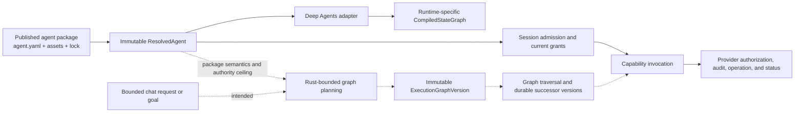

# Kiteframe V1 Design State

- **Status:** State audit; not a replacement normative specification
- **Date:** 2026-08-04
- **Repository:** `swiftdiaries/kiteframe`
- **Audited HEAD:** `6f624fc5d74be9b603288a269894ee368db140e7`
- **Scope:** Reusable agent packages and the intended per-request task-graph
  language

## Executive finding

Kiteframe currently has one implemented declarative layer: a reusable,
versioned agent package rooted in `agent.yaml`. Rust validates that package,
locks its capability dependencies, resolves it into immutable `ResolvedAgent`
IR, and passes closed runtime inputs to the Deep Agents adapter. A chat request
does not construct a new `agent.yaml`.

The current design intent adds a second declarative layer: a narrow task-graph
language computed for each bounded request or goal. That layer is conceptually
separate from the agent package. The package defines the reusable agent,
available skills, model requirements, delegation boundary, and maximum
capability envelope; the request graph would define the temporary reasoning
and execution structure for one goal within those bounds.

That two-layer intent is not represented by the current normative spec or
implementation. The repository contains no Kiteframe `GoalSpec`,
`PlanningEnvelope`, `ExecutionGraphVersion`, `GraphPlanner`, `GraphCompiler`,
`TransitionEvaluator`, `ResumeBundle`, `ExecutionSnapshot`, or `RunStore`.
There is no graph-source schema, parser, compiler, durable graph store, or
conformance suite. The founding design and current roadmap instead explicitly
exclude a workflow or graph DSL.

The design has therefore drifted in two directions:

1. the founding spec and roadmap no longer describe the intended product; and
2. the intended per-request graph layer has not yet been made normative or
   implemented.

This document records that state without treating intended architecture as
delivered behavior.

## Evidence model

Claims in this audit use four evidence classes:

| Class | Meaning |
|---|---|
| Implemented and tested | Source contracts and behavior exist at the audited HEAD and have corresponding tests or fixtures. |
| Normative design | An approved checked-in specification defines required behavior, whether or not implementation exists. |
| Planning or worktree intent | A plan, uncommitted document, or current design direction proposes behavior but does not prove a contract or implementation. |
| Absent or unknown | The audited repository contains no authoritative contract or implementation evidence. |

Names used by an upstream runtime are not evidence of a Kiteframe-owned
contract. In particular, Deep Agents' `CompiledStateGraph`, LangGraph
checkpoint task identifiers, Kiteframe authorization `TaskRef` values,
capability `InvocationRequest` values, and provider invocation storage are
distinct from the proposed Kiteframe task-graph language.

## Current agent and package design

### Author-time package

`agent.yaml` is an exhaustive, versioned manifest within a reusable directory
package. The package also references prompt and skill assets, nested agent
packages, runtime binding overlays, and a generated `capability.lock`.

The manifest is not request-scoped. It declares reusable facts:

- package identity and version;
- prompts and skills;
- model roles and constraints;
- semantic capability requirements and resource ceilings;
- declared child-agent delegation; and
- required and optional runtime features.

It intentionally contains no workflow steps. Preserving that rule is
compatible with a separate per-request graph language: graph source should
refer to package-owned tasks, child agents, and capabilities without mutating
or synthesizing the package itself.

### Implemented lifecycle

The implemented path is:

1. Rust parses `AgentManifest` and loads a contained, validated `AgentPackage`.
2. `kiteframe lock` selects exact capability descriptors into
   `capability.lock`.
3. resolution combines the verified package, exact lock, runtime binding, and
   target component metadata into canonical `ResolvedAgent` IR.
4. PyO3 exposes immutable projections and closed `ResolvedRuntimeInputs`.
5. the Deep Agents adapter validates the target and trusted components, then
   calls the pinned public `create_deep_agent(...)` constructor.
6. session admission and point-of-use provider checks dynamically narrow the
   package's declared capability ceiling.

The resulting Deep Agents `CompiledStateGraph` is a runtime-specific compiled
agent artifact. It does not establish a Kiteframe graph-source format or prove
per-request Kiteframe graph compilation.

## Current task-graph design

### Intended role

The current product direction is a narrow task-graph language computed for
each bounded chat request or goal. It is not a replacement for `agent.yaml` and
is not intended to become a general-purpose workflow or programming language.

The intended separation is:

| Layer | Reuse and cardinality | Responsibility |
|---|---|---|
| Agent package | Authored and versioned once; reused across requests | Stable prompts, skills, model requirements, child-agent declarations, capability ceiling, and safety requirements |
| Request graph | Computed for one bounded request or goal | Temporary task decomposition, typed task inputs and outcomes, context projection, dependencies, continuation, and replanning |
| Capability invocation | Zero or more calls from a graph task | One authorized semantic operation with current grants, evidence, idempotency, audit, and status |

The proposed architecture uses Rust-owned, typed, bounded, immutable, and
acyclic graph versions. A model may propose graph source, but Rust must validate
and compile it before execution. Replanning should create a hash-linked
successor graph at a durable barrier rather than mutate the active graph;
completed effects must not be replayed. Authority must only narrow from the
resolved package through graph tasks, child calls, session grants, and
point-of-use authorization.

These invariants are current design intent, not current repository contracts.
They need a normative design and implementation plan before callers can depend
on them.

### Missing normative and implementation artifacts

The audited repository does not define:

- graph-source syntax or a generated schema;
- `GoalSpec` or a bounded planner input contract;
- `PlanningEnvelope` and its authority/context ceiling;
- `ExecutionGraphVersion` node, edge, identity, digest, and limit rules;
- task input, output, continuation, fork, join, return, or cancellation types;
- a Rust `GraphPlanner` or `GraphCompiler`;
- a `TransitionEvaluator` and deterministic traversal semantics;
- durable `RunStore`, `ExecutionSnapshot`, `ResumeBundle`, or successor-graph
  persistence;
- the relationship between graph task identity and authorization `TaskRef`;
  or
- graph parser, compiler, adversarial, restart, successor, and end-to-end
  tests.

Until those artifacts exist, Kiteframe does not currently compute or execute a
Kiteframe-owned task graph for every request.

## Request lifecycle

The solid path below exists. The dotted path records the intended graph layer.

The graph planner must consume the already resolved package and bounded request
context. It must not generate a new package from chat, add capabilities,
introduce undeclared child agents, or bypass runtime and provider enforcement.

## Design drift matrix

| Claim and location | Current evidence | Drift | Required correction |
|---|---|---|---|
| The founding spec says Kiteframe defines packages and capabilities "without defining a workflow language" (`docs/superpowers/specs/2026-07-25-kiteframe-declarative-agent-harness-design.md:9-37`). | True for the implementation at HEAD; false for current product intent. | Normative design excludes the intended request graph. | Replace the blanket exclusion with the two-layer boundary and retain the exclusion of a general-purpose workflow/programming language. |
| V1 explicitly excludes a workflow DSL, graph DSL, planner language, and execution engine (`docs/superpowers/specs/2026-07-25-kiteframe-declarative-agent-harness-design.md:87-103`). | No replacement graph contract is checked in. | The statement is product-design drift, but simply deleting it would imply unsupported behavior. | Supersede it alongside a normative graph design, ownership model, roadmap, and acceptance criteria. |
| The manifest contains no workflow steps (`docs/superpowers/specs/2026-07-25-kiteframe-declarative-agent-harness-design.md:240-317`). | Supported by manifest types, schemas, fixtures, and package loading. | No drift. This remains a necessary layer boundary. | Keep it and add that per-request graph source is a separate artifact bounded by the resolved package. |
| The README frames Kiteframe around Wave 2 lock, resolve, and compile behavior (`README.md:5-33`). | Waves 3R, 4, and 5 are implemented at HEAD; the graph layer is absent. | README is stale even before describing graph intent. | Describe the implemented package, Python, Deep Agents, and enforcement surfaces; label the request graph as design direction until implemented. |
| The roadmap assigns no wave to a Kiteframe graph contract, compiler, or runtime (`docs/superpowers/plans/2026-07-25-kiteframe-v1-wave-roadmap.md:43-97`). | Exact symbol and history searches found no graph implementation. | The delivery plan cannot produce the intended two-layer V1. | Add an independently reviewable graph-contract/compiler/runtime wave or explicitly move the graph layer outside V1. |
| Current worktree roadmap prose assigns task synthesis to the host and denies a Kiteframe workflow DSL (`docs/superpowers/plans/2026-07-25-kiteframe-v1-wave-roadmap.md:116-155`). | The prose is uncommitted and conflicts with current requested intent. | Active documentation is moving further from the intended design. | Reconcile before committing: preserve host ownership of chat UX while moving bounded graph planning and validation into Kiteframe. |
| Wave 4 says the adapter returns a compiled graph (`docs/superpowers/plans/2026-07-25-kiteframe-v1-wave-4-deep-agents.md:423-477`). | Source calls Deep Agents and returns its `CompiledStateGraph`. | Terminology can be misread as Kiteframe graph-DSL implementation. | Qualify it consistently as the runtime-specific Deep Agents/LangGraph artifact. |
| The founding spec still says it does not authorize runtime implementation (`docs/superpowers/specs/2026-07-25-kiteframe-declarative-agent-harness-design.md:33-37`). | Runtime construction and enforcement are implemented through Wave 5. | Status prose is historical. | Convert the document to a maintained normative spec or clearly mark historical approval context. |

## Implementation state

| Surface | State at audited HEAD | Evidence |
|---|---|---|
| Agent manifest and contained package loading | Implemented and tested | `crates/kiteframe-contract/src/manifest.rs:211-219`; `crates/kiteframe-core/src/load.rs:20-101` |
| Exact capability lock, deterministic resolution, canonical IR, CLI | Implemented and tested | `crates/kiteframe-contract/src/ir.rs:140-160`; `crates/kiteframe-resolver/src/resolve.rs:30-58`; `crates/kiteframe-cli/src/command.rs:161-238` |
| Immutable Python projections and resolved runtime inputs | Implemented and tested | `crates/kiteframe-py/src/ir.rs:872-899`; `crates/kiteframe-py/src/validate.rs:46-94` |
| Deep Agents package adapter and runtime-specific compiled graph | Implemented and tested | `python/kiteframe-deepagents/src/kiteframe_deepagents/adapter.py:136-166`; `python/kiteframe-deepagents/src/kiteframe_deepagents/adapter.py:336-458` |
| Admission, point-of-use authorization, provider invocation state, audit | Implemented through Wave 5 | `crates/kiteframe-contract/src/service.rs`; `crates/kiteframe-provider/src`; `crates/kiteframe-provider-http/src` |
| Per-request Kiteframe graph source and schema | Absent | No matching contract, schema, fixture, or parser at HEAD or in available git history |
| Rust graph planner/compiler/transition evaluator | Absent | No matching source symbols at HEAD or in available git history |
| Immutable graph versions, successor graphs, snapshots, resume bundles, run store | Design intent only | No matching source, schema, persistence contract, or tests |
| End-to-end request planning and graph execution | Absent | Existing end-to-end coverage exercises package/runtime/provider behavior, not Kiteframe graph planning |

`TaskRef` is currently a validated correlation and authorization reference in
the service contract (`crates/kiteframe-contract/src/service.rs:47`,
`crates/kiteframe-contract/src/service.rs:518-539`, and
`crates/kiteframe-contract/src/service.rs:1115-1135`). `InvocationRequest`
describes one capability call (`crates/kiteframe-contract/src/service.rs:1508-1524`).
Neither type currently defines a graph task node.

## Recommended synchronization

1. Write and approve a normative per-request task-graph design before claiming
   the layer as implemented.
2. Revise the founding design to define the package and request-graph layers,
   their different lifecycles, and their one-way authority relationship.
3. Update the root README to describe the implementation through Wave 5 and
   separately label the request graph as designed, planned, or implemented.
4. Add a roadmap wave for graph contracts, parser/compiler, durable execution,
   successor/replanning semantics, runtime integration, and conformance proof.
5. Reserve distinct names for `ExecutionGraphVersion`, Deep Agents'
   `CompiledStateGraph`, authorization `TaskRef`, LangGraph checkpoint tasks,
   and provider invocation state.
6. Add a requirement-to-evidence matrix so future docs distinguish approved
   design, implemented prerequisites, adapter compatibility, and running graph
   behavior.

## Open decisions

The normative graph design must answer:

1. Is the request graph mandatory for Kiteframe V1, or a later delivery built
   on the V1 package/enforcement foundation?
2. What exactly bounds one graph: a user message, clarified goal, task,
   conversation turn, or durable run?
3. Does a host or a Kiteframe-owned planner propose graph source, and what is
   the exact `PlanningEnvelope` input?
4. Which task kinds may appear, and how are typed inputs, outcomes, context
   projections, limits, and callable sets represented?
5. How do graph task identities map to the existing authorization `TaskRef`
   without conflating the two contracts?
6. How do `RunStore`, provider `InvocationStore`, and LangGraph checkpointing
   divide ownership and recovery responsibility?
7. Where are replanning barriers legal, and which completed, suspended, or
   uncertain effects must a successor graph import?
8. Which graph semantics are portable, and which remain adapter-specific?

## Evidence index

### Package and runtime implementation

- `crates/kiteframe-contract/src/manifest.rs:211-219` — `AgentManifest`.
- `crates/kiteframe-core/src/load.rs:20-101` — validated package loading.
- `crates/kiteframe-contract/src/ir.rs:140-160` — immutable
  `ResolvedAgent` contract.
- `crates/kiteframe-resolver/src/resolve.rs:30-58` — resolution entry point.
- `crates/kiteframe-cli/src/command.rs:161-238` — lock and compile commands.
- `crates/kiteframe-py/src/ir.rs:872-899` — resolved runtime inputs.
- `python/kiteframe-deepagents/src/kiteframe_deepagents/adapter.py:136-166` —
  adapter validation and inputs.
- `python/kiteframe-deepagents/src/kiteframe_deepagents/adapter.py:336-458` —
  pinned public runtime construction.

### Design and planning

- `docs/superpowers/specs/2026-07-25-kiteframe-declarative-agent-harness-design.md:9-37`
  — founding scope and package/runtime summary.
- `docs/superpowers/specs/2026-07-25-kiteframe-declarative-agent-harness-design.md:87-103`
  — explicit DSL and execution-engine non-goal.
- `docs/superpowers/specs/2026-07-25-kiteframe-declarative-agent-harness-design.md:240-317`
  — package layout, manifest, and no-workflow-step rule.
- `docs/superpowers/plans/2026-07-25-kiteframe-v1-wave-roadmap.md:43-97`
  — committed wave coverage.
- `docs/superpowers/plans/2026-07-25-kiteframe-v1-wave-roadmap.md:116-155`
  — pre-existing worktree-only user-journey ownership and no-task-synthesis
  language.
- `docs/superpowers/plans/2026-07-25-kiteframe-v1-wave-4-deep-agents.md:423-477`
  — Deep Agents public constructor and runtime-specific compiled graph.

### History search

- `f210869` introduced the founding design's workflow-DSL exclusion.
- No available commit contains the requested graph vocabulary according to
  exact `git log --all -G` searches.
- Historical hint `5c4475b` is not a resolvable object in the audited
  repository and is not used as evidence.
